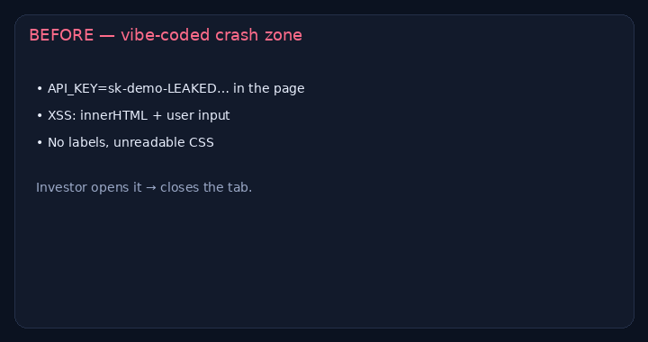

# Before/after: vibe-coded app rescue

> **For non-technical clients — start here**
>
> **What it does:** Takes a broken AI-generated app (Lovable, Bolt, Cursor, Claude Code…) and makes it safe to share: fix bugs, remove leaked keys, improve accessibility, help you ship.
>
> **Try it in 1 click:** open the [**landing**](https://cdn.jsdelivr.net/gh/nyyoautomation/nyyo-vibe-code-rescue@main/index.html), click **Before** then **After**. Try pasting HTML into the task box on both.
>
> **Business benefit:** stop losing trust (or leaking keys) because the demo is rough. Fixes from **$50**, audit + production from **$299**.

**Live:** https://cdn.jsdelivr.net/gh/nyyoautomation/nyyo-vibe-code-rescue@main/index.html  
**Audit:** [audit.md](./audit.md)

## Hire me
[LaborX — Nyyo Automation](https://laborx.com/freelancers/users/id475124) · [Profile](https://github.com/nyyoautomation)

🇫🇷 Français

Réparation d'apps « vibe coded ». [Avant/après](https://cdn.jsdelivr.net/gh/nyyoautomation/nyyo-vibe-code-rescue@main/index.html). À partir de **50 $**.

